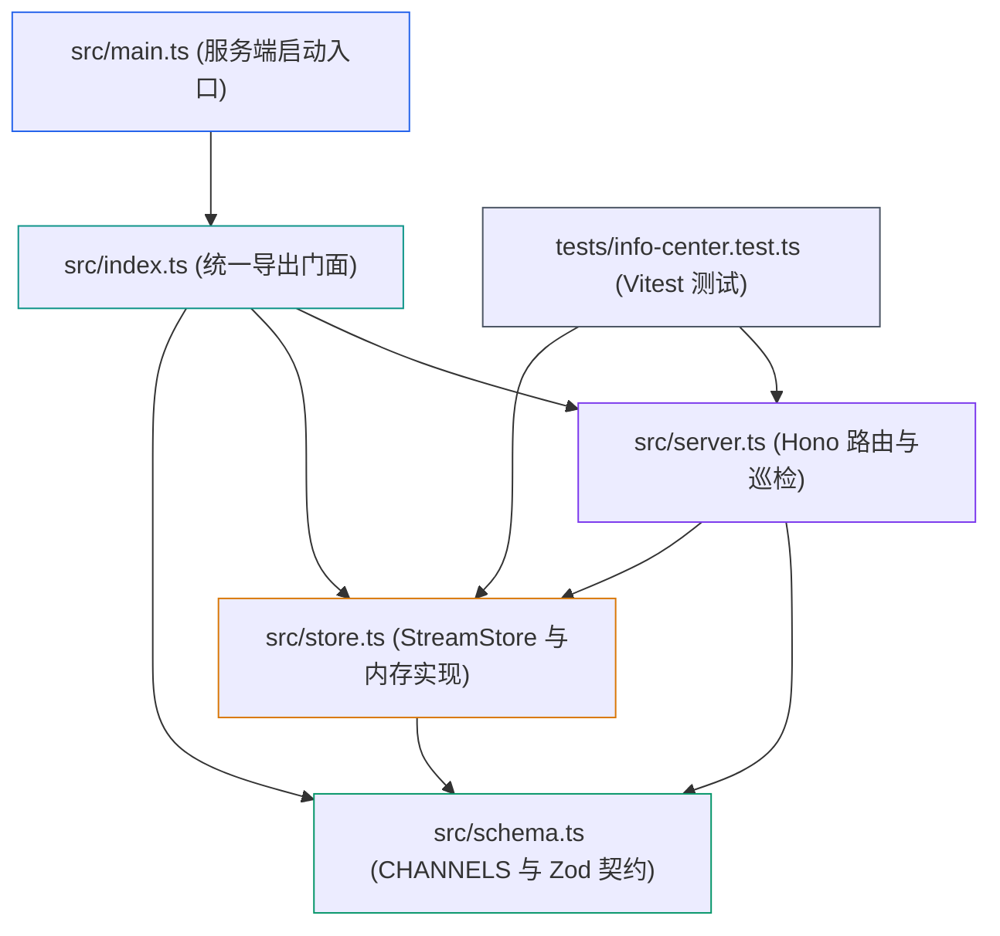
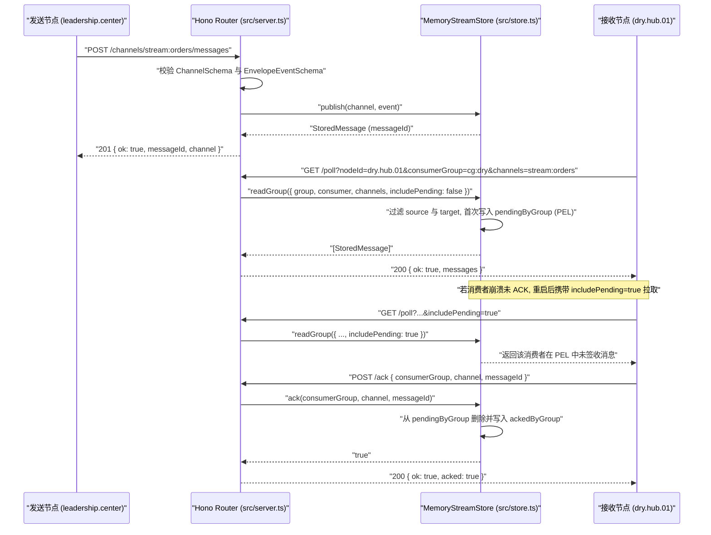
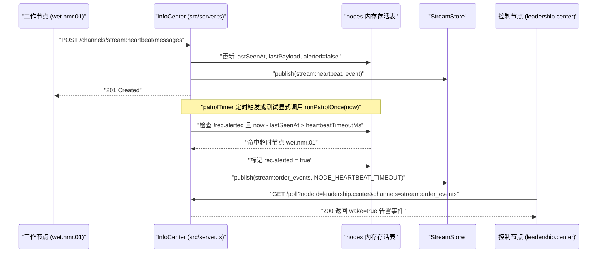

<!--
@file docs/architecture.md
@description World Bus 信息中心架构设计文档
@date 2026-11-20
@version 0.1.0
-->

# World Bus Information Center 架构设计文档

## 1. 架构概览与分层原则

信息中心采用轻量级分层架构, 将 **运行入口装配**, **HTTP 协议与巡检协调**, **存储抽象与实现**, **数据契约校验** 严格解耦:

- **无副作用核心包**: `src/index.ts` 对外暴露 `createInfoCenter`, `MemoryStreamStore` 与契约 Schema, 任何调用方或测试代码导入 `src/index.ts` 时不会隐式绑定端口或开启全局定时器.
- **运行时与测试配置分离**: `createInfoCenter()` 工厂内部默认关闭后台巡检定时器 (`patrolIntervalMs = 0`), 由测试通过 `runPatrolOnce(now)` 确定性驱动; `src/main.ts` 服务端入口则默认启用 `60000ms` 定时巡检与 `0.0.0.0:3200` 端口监听.
- **存储可替换接口**: 路由层仅依赖 `StreamStore` 接口, 当前提供 `MemoryStreamStore` 1:1 模拟 Redis Stream 消费组与 PEL 机制, 后续可平滑替换为 Redis / SQLite 等持久化实现.

---

## 2. 模块依赖与组件架构

### 各模块职责明细

| 文件 | 核心导出 | 职责说明 |
| --- | --- | --- |
| [src/schema.ts](file:///c:/codeSpace/world-bus-information-center/src/schema.ts) | `CHANNELS`, `ChannelSchema`, `EnvelopeEventSchema`, `StoredMessage` | 定义频道白名单, 事件信封 Zod v3 校验规则与存储消息类型 |
| [src/store.ts](file:///c:/codeSpace/world-bus-information-center/src/store.ts) | `StreamStore`, `MemoryStreamStore` | 抽象消息流发布, 消费组拉取, PEL 跟踪, 签收及流统计接口与内存实现 |
| [src/server.ts](file:///c:/codeSpace/world-bus-information-center/src/server.ts) | `createInfoCenter`, `InfoCenterOptions`, `NodeHeartbeatRecord` | 装配 Hono HTTP 路由 (`/health`, `/channels/:channel/messages`, `/poll`, `/ack`), 维护内存节点存活表并执行巡检 |
| [src/index.ts](file:///c:/codeSpace/world-bus-information-center/src/index.ts) | 上述 3 个模块全部公共符号与类型 | 提供包入口 (`dist/index.js`) 与无启动副作用的统一导入点 |
| [src/main.ts](file:///c:/codeSpace/world-bus-information-center/src/main.ts) | 可执行服务端进程 | 解析环境变量, 通过 `@hono/node-server` 启动 HTTP 服务, 注册 `SIGINT` / `SIGTERM` 优雅退出 |

---

## 3. 核心交互时序

### 3.1 消息投递, 消费组隔离, PEL 重投与签收流程

### 3.2 心跳上报与超时巡检流程

---

## 4. 关键数据结构与实现机制

### 4.1 `MemoryStreamStore` 内部索引

[src/store.ts](file:///c:/codeSpace/world-bus-information-center/src/store.ts) 通过 3 个内存集合实现消费组隔离:

- `streams`: `Map<ChannelName, StoredMessage[]>`, 初始化包含 4 个固定白名单频道, 按投递顺序追加存储.
- `pendingByGroup`: `Map<group, Map<ChannelName, Map<messageId, { consumer, deliveredAt }>>>`, 记录已投递但尚未签收的 PEL 归属, 避免同消费组多个消费者重复领取同一消息.
- `ackedByGroup`: `Map<group, Map<ChannelName, Set<messageId>>>`, 记录消费组内已完成 `/ack` 的消息 ID 集合.
- `messageId` 生成规则: `${Date.now()}-${++this.seq}`, 在单进程内存生命周期内保证单调递增与可区分性.

### 4.2 定时器生命周期与进程退出

- `createInfoCenter()` 若传入 `patrolIntervalMs > 0`, 会调用 `setInterval(...).unref()`, 确保后台巡检定时器不会单独阻塞 Node.js 事件循环退出.
- `src/main.ts` 监听 `SIGINT` 与 `SIGTERM`, 通过 `isShuttingDown` 守卫防止重入, 先调用 `infoCenter.shutdown()` 清理定时器, 再调用 `server.close()` 优雅关闭 HTTP 连接.

### 4.3 运行时配置与构建布局

- `tsconfig.json`: 设置 `"rootDir": "src"`, `"outDir": "dist"`, `"declaration": true`, `"module": "NodeNext"`, `"moduleResolution": "NodeNext"`.
- `tsconfig.test.json`: 继承 `tsconfig.json`, 覆盖 `"rootDir": "."` 与 `"noEmit": true`, 将 `tests/**/*` 纳入 `npm run typecheck`.
- 相对路径导入统一保留 `.js` 后缀, 以原生兼容 Node.js ESM (`"type": "module"`).

---

## 5. 当前架构局限与演进方向

1. **进程内易失状态**: `MemoryStreamStore` 的消息队列, PEL, 已签收集合以及 `server.ts` 的 `nodes` 心跳表均驻留内存, 进程重启会丢失全部队列与节点状态.
2. **内存无限增长风险**: 当前未对 `streams` 数组与 `ackedByGroup` 集合做上限裁剪 (`MAXLEN` / TTL), 长期运行会线性占用内存.
3. **跨进程多实例限制**: 内存实现仅适用于单实例进程; 若需多副本部署或持久化重启恢复, 需实现基于 Redis Streams (`XADD` / `XREADGROUP` / `XACK`) 的 `StreamStore` 适配器并外置节点心跳状态.
